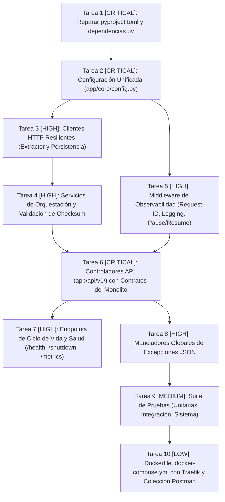

# Análisis Previo del Monolito y Base del Orquestador (Fase 0)

> **Estado:** Completado (Solo Lectura, sin modificación de código de aplicación)  
> **Fecha:** 2026-10-19  
> **Fuentes Analizadas:**  
> 1. Monolito: `C:\Users\santi\OneDrive\Documentos\Materiales-Facu\2026\Desarrollo-de-Software\pdf-extractortext`  
> 2. Base del Orquestador: `C:\Users\santi\OneDrive\Documentos\Materiales-Facu\2026\Desarrollo-de-Software\pdf-extractortext-microservice\orchestrator-microservice_pdf-extractortext`  
> 3. Especificación: `microservicios.txt`  

---

## 1. Confirmación o Descarte de Puntos Específicos

### a) Lógica de extracción de PDF: `app/services/pdf_service.py`, `app/infrastructure/pdf/pdf_service.py` y `app/application/pdf/pdf_extractor.py`. ¿Hay duplicidad?
- **Resultado:** **CONFIRMADA LA DUPLICIDAD Y CÓDIGO HUÉRFANO.**
- **Evidencia y Detalle:**
  1. `app/services/pdf_service.py`: Implementación monolítica previa que define `PdfService`, `PdfProcessingResult` y `PdfProcessingError`. Contiene extracción con `pypdf` y cálculo de hash `sha256`. Ningún módulo de producción ni test utiliza la clase `PdfService` de este archivo. Solo `app/api/routes.py:11` y `tests/integration/test_routes_error_mapping.py:16` importan su excepción `PdfProcessingError`. Es código muerto en un 90%.
  2. `app/infrastructure/pdf/pdf_service.py`: Wrapper redundante que envuelve a `PypdfPdfExtractor`. Declara implementar `PdfExtractor`, pero es incompleto (carece del método `process_pdf`). Solo es llamado por un test unitario (`tests/unit/test_pdf_extractor.py:18, 38, 100`). La aplicación principal (`app/api/dependencies.py:15, 53`) inyecta directamente `PypdfPdfExtractor`, ignorando este wrapper.
  3. `app/application/pdf/pdf_extractor.py` y `app/infrastructure/pdf/pypdf_extractor.py`: Son el puerto (`Protocol`) y el adaptador oficial activos en la arquitectura hexagonal.
- **Impacto para el Orquestador:** El orquestador no debe contener ninguna de estas tres implementaciones de extracción de PDF. La lógica de extracción corresponde íntegramente al microservicio `extractor`.

---

### b) Dos módulos de configuración: `app/config/settings.py` y `app/application/config_service.py`.
- **Resultado:** **CONFIRMADA LA DUPLICIDAD Y USO INCONSISTENTE.**
- **Evidencia y Detalle:**
  1. `app/config/settings.py`: Define `Settings(BaseSettings)` con variables de entorno para MongoDB, tamaños de archivo, nombres y versiones. Usa la sintaxis deprecada en Pydantic V2 (`class Config: env_file = ...`).
  2. `app/application/config_service.py`: Define un protocolo `ConfigService` y un factory `get_config_service()` que envuelve a `get_settings()` en una clase anidada `ConcreteConfigService`.
  3. **Inconsistencia de consumo:** En `app/api/routes.py`, las rutas usan `Depends(get_config_service)` para paginación y validación de tamaño (L89, L151), pero en el endpoint `/health` (L360) se importa y llama directamente `get_settings()`. Asimismo, `app/main.py:8, 34` y `app/infrastructure/persistence/database.py:7, 35` llaman directamente a `get_settings()`.
- **Impacto para el Orquestador:** Se debe eliminar la sobre-abstracción de `ConfigService`. El orquestador debe usar un único módulo limpio `app/core/config.py` con `pydantic-settings` (usando `SettingsConfigDict`), sin variables de MongoDB, conteniendo únicamente las URLs de los microservicios downstream (`extractor`, `persistencia`), timeouts, configuración de reintentos y nivel de logs.

---

### c) Endpoint legacy `upload_document_legacy` junto a `upload_document` en `app/api/routes.py`. ¿Qué contrato expone y lo usa el frontend?
- **Resultado:** **DESCARTADO EL USO POR EL FRONTEND; CONTRATO LEGACY IDENTIFICADO.**
- **Evidencia y Detalle:**
  1. **Contrato expuesto por `upload_document_legacy` (`POST /api/v1/documents/`):**
     - Recibe: `file: UploadFile` (`multipart/form-data`).
     - Devuelve: `PlainTextResponse` con encabezado `Content-Disposition: attachment; filename="<name>.txt"` conteniendo el texto plano extraído sin formato JSON.
  2. **Contrato expuesto por `upload_document` (`POST /api/v1/documents/upload`):**
     - Recibe: `file: UploadFile` (`multipart/form-data`).
     - Devuelve: JSON `DocumentResponseDTO` (`{"id": str, "checksum": str, "extracted_text": str, "created_at": datetime}`).
  3. **Verificación en el Frontend (`frontend/index.html`):**
     - En las líneas 393-408:
       ```javascript
       const response = await fetch(`${API_BASE_URL}/api/v1/documents/upload`, {
           method: 'POST',
           body: formData
       });
       const data = await response.json();
       extractedTextContent = data.extracted_text;
       displayResults(extractedTextContent, data.checksum);
       ```
     - La descarga del archivo `.txt` la realiza el cliente en el navegador mediante JavaScript (`downloadText()` en L477 crea un `Blob` local).
     - La afirmación en el docstring de `routes.py` (*"Consumidor actual: frontend web (frontend/index.html)"*) es **falsa / obsoleta**.
  4. **Verificación en Tests:** Ningún test en la suite de pruebas llama a `POST /api/v1/documents/` para subida.
- **Impacto para el Orquestador:** El endpoint `POST /api/v1/documents/upload` es el único activo y requerido por el frontend. `upload_document_legacy` no es consumido por ningún cliente del repositorio.

---

### d) Conflicto de especificación: Descubrimiento con Consul vs URLs por variables de entorno.
- **Resultado:** **CONFLICTO CONFIRMADO ENTRE ESPECIFICACIONES.**
- **Evidencia y Detalle:**
  - `microservicios.txt` (L51): Especifica `Discovery Service (Cónsul HashiCorp)` y en L63 menciona `/shutdown apaga el servidor de configuración`.
  - `microservicios.txt` (L35-36): Especifica `no lleva variables de entorno para DB; llevara las variable de entorno para conectarse al resto de microservicios`.
  - Instrucciones del usuario: *"El orquestador NO tiene variables de entorno de base de datos. Sí tiene variables con la URL de cada microservicio al que llama (extractor, persistencia)"* y *"Fuera de alcance en esta ejecución: No implementes Kafka, Consul..."*.
  - Regla: *"No elijas una opción sin preguntarme."*
- **Análisis de Opciones:**
  - **Opción A (Variables de entorno con URLs directas / DNS de Docker Compose):**
    - *Funcionamiento:* El orquestador lee `EXTRACTOR_URL=http://extractor:8001` y `PERSISTENCE_URL=http://persistence:8002`. Traefik gestiona el proxy y balanceo.
    - *Ganancia:* Simplicidad absoluta, cero dependencias complejas, rápida ejecución y depuración local.
    - *Pérdida:* Menor dinamismo en escalado horizontal dinámico multi-host sin DNS.
  - **Opción B (Service Discovery con HashiCorp Consul):**
    - *Funcionamiento:* Los servicios se auto-registran en Consul; el orquestador consulta el catálogo de Consul para resolver las direcciones IP/puertos de las instancias activas.
    - *Ganancia:* Desacoplamiento de topología de red dinámica en clústeres heterogéneos.
    - *Pérdida:* Alta complejidad, latencia extra por resolución, sobrecarga de infraestructura innecesaria para un entorno de 4 contenedores gestionados por Traefik.
- **Estado:** Se mantiene como **decisión abierta pendiente de confirmación del usuario**. En la Fase 0/1 se preparan las abstracciones (puertos) para que el cambio de proveedor sea transparente.

---

### e) ¿El cálculo de checksum y el chequeo de duplicados pertenecen al orquestador o a persistencia?
- **Resultado:** **RESPONSABILIDADES DELIMITADAS: CÁLCULO EN ORQUESTADOR (OPTIMIZACIÓN FAIL-FAST), CHEQUEO Y UNICIDAD EN PERSISTENCIA.**
- **Evidencia y Detalle:**
  1. **Cálculo de Checksum SHA-256 (`hashlib.sha256(bytes).hexdigest()`):**
     - Es una función matemática pura en memoria, sin I/O, de bajo costo computacional (~1-2 ms para 10 MB).
     - Si el orquestador calcula el checksum apenas recibe el archivo, puede consultar a persistencia: *"¿Existe ya el hash `abc123...`?"*.
     - Si existe, el orquestador responde inmediatamente `HTTP 409 Conflict`, **evitando transferir 10 MB por red al extractor y evitando procesar el PDF inútilmente**.
     - Si no existe, continúa el flujo hacia el extractor.
  2. **Chequeo de Duplicados e Integridad:**
     - La base de datos reside exclusivamente en el microservicio de persistencia. El orquestador tiene estrictamente prohibido acceder a MongoDB.
     - Por lo tanto, el chequeo de duplicados (`find_by_checksum`) debe ser expuesto por el microservicio de persistencia (ej. `GET /api/v1/documents/checksum/{checksum}` o validación previa en `POST /api/v1/documents/`).
     - Además, persistencia debe aplicar un índice único a nivel de base de datos para evitar condiciones de carrera (TOCTOU).
- **Impacto para el Orquestador:** El orquestador calcula el hash en memoria y delega la verificación de existencia al cliente HTTP de persistencia.

---

## 2. Hallazgos Críticos del Análisis (Formato Estructurado)

### Hallazgo 1: Configuración de build rota en la Base del Orquestador
- **Archivo y Línea:** `orchestrator-microservice_pdf-extractortext/pyproject.toml:12-18`
- **Severidad:** `[CRITICAL]`
- **Evidencia:**
  ```toml
  [tool.uv]
  packages = ["**/*.py"]
  exclude = [".python-version"]

  [build-system]
  requires = ["setuptools>=68.0", "wheel"]
  build-backend = "setuptools.backends._legacy:_Backend"
  ```
  Al ejecutar `uv run pytest`, falla con:
  `ModuleNotFoundError: No module named 'setuptools.backends'` y `unknown field packages under [tool.uv]`.
- **Cambio Propuesto:** Migrar el `pyproject.toml` al estándar moderno con `hatchling` (igual que el monolito) o `setuptools.build_meta`, definiendo dependencias completas (`fastapi`, `uvicorn`, `httpx`, `pydantic-settings`, etc.) y `[project.optional-dependencies] dev = ["pytest", "pytest-asyncio", "respx"]`.
- **Compromiso:**
  - *Se gana:* Capacidad de ejecutar el entorno virtual, linters, tests locales y Docker builds de forma determinista con `uv`.
  - *Se pierde:* Ninguna funcionalidad legítima (la actual está rota).
- **Esfuerzo:** `[< 1 día]`

---

### Hallazgo 2: Persistencia falsa en memoria en la Base del Orquestador
- **Archivo y Línea:** `orchestrator-microservice_pdf-extractortext/app/infrastructure/http_client.py:132-164` y `app/infrastructure/repository.py:1-25`
- **Severidad:** `[CRITICAL]`
- **Evidencia:**
  ```python
  class DocumentRepositoryInfrastructure:
      def __init__(self, http_client: SimulatedHTTPClient | None = None) -> None:
          self._http_client = http_client
          self._storage: dict[str, Document] = {}

      async def save(self, document: Document) -> Document:
          self._storage[document.id] = document
          return document
  ```
- **Observación:** El orquestador implementa un repositorio con almacenamiento interno en memoria (`self._storage`), violando el principio fundamental de microservicios: el orquestador es stateless y no debe persistir datos. Toda persistencia debe delegarse por HTTP al microservicio de persistencia.
- **Cambio Propuesto:** Reemplazar `DocumentRepositoryInfrastructure` por un cliente HTTP REST real hacia el microservicio de persistencia (`PersistenceClient`), que implemente llamadas a `/api/v1/documents`.
- **Compromiso:**
  - *Se gana:* Conformidad con la arquitectura de microservicios y statelessness del orquestador.
  - *Se pierde:* Persistencia en memoria local de juguete.
- **Esfuerzo:** `[< 1 día]`

---

### Hallazgo 3: Ausencia de los contratos y endpoints reales del Monolito en el Orquestador
- **Archivo y Línea:** `orchestrator-microservice_pdf-extractortext/app/presentation/api/v1/endpoints.py:26-46`
- **Severidad:** `[CRITICAL]`
- **Evidencia:**
  Solo existen endpoints de prueba:
  - `POST /documents/` (devuelve `status.HTTP_202_ACCEPTED` con payload estático `{"example": "payload"}`).
  - `GET /documents/{document_id}/validate` (devuelve `{"valid": True}`).
  No existen las rutas que el frontend consume:
  - `POST /api/v1/documents/upload`
  - `GET /api/v1/documents/` (con paginación `skip` y `limit`)
  - `GET /api/v1/documents/{document_id}`
  - `PUT /api/v1/documents/{document_id}`
  - `DELETE /api/v1/documents/{document_id}`
  - `GET /health`, `/shutdown`, `/pause`, `/resume`, `/metrics`
- **Cambio Propuesto:** Implementar los controladores en 3 capas respetando estrictamente los prefijos y rutas del monolito (`/api/v1/documents/...`) para garantizar transparencia total frente al frontend.
- **Compromiso:**
  - *Se gana:* Compatibilidad completa con el frontend existente y contratos estables.
  - *Se pierde:* Ninguno.
- **Esfuerzo:** `[< 1 semana]`

---

### Hallazgo 4: Falta de patrón Retry, Timeouts y propagación de Request-ID en clientes HTTP
- **Archivo y Línea:** `orchestrator-microservice_pdf-extractortext/app/infrastructure/http_client.py:8-105`
- **Severidad:** `[HIGH]`
- **Evidencia:**
  `SimulatedHTTPClient` realiza llamadas simples sin política de reintentos (`retry`), sin backoff exponencial, sin manejo de caídas de red transitorias y sin inyectar cabeceras de correlación `X-Request-ID`.
- **Cambio Propuesto:** Diseñar una capa de clientes HTTP (`app/clients/`) con soporte de timeouts configurables, reintentos con backoff exponencial para errores 5xx y fallos de conexión (usando `tenacity` o lógica async nativa), e inyección automática del `X-Request-ID` proveniente del contexto de la petición entrante.
- **Compromiso:**
  - *Se gana:* Resiliencia ante fallos transitorios en la red inter-servicio y trazabilidad distribuida de logs.
  - *Se pierde:* Cero sobrecarga, delegando circuit breaker a Traefik según las restricciones dadas.
- **Esfuerzo:** `[< 1 día]`

---

### Hallazgo 5: Ausencia de endpoints de ciclo de vida seguro (`/shutdown`, `/pause`, `/resume`, `/metrics`) y `/health` desacoplado
- **Archivo y Línea:** `orchestrator-microservice_pdf-extractortext/app/main.py` y `pdf-extractortext/app/api/routes.py:343-385`
- **Severidad:** `[HIGH]`
- **Evidencia:**
  - En el monolito, `/health` comprueba únicamente `database.is_connected()`.
  - En la base del orquestador, no existe ningún endpoint de ciclo de vida ni observabilidad.
  - La especificación exige:
    - `/health`: debe verificar la conectividad con sus dependencias (`extractor` y `persistencia`).
    - `/shutdown`: apagado controlado esperando que finalicen las peticiones en curso (graceful shutdown).
    - `/pause` y `/resume`: detener temporalmente la admisión de nuevas peticiones (devolviendo 503) y reanudarlas.
    - `/metrics`: exponer métricas básicas de peticiones y latencia.
- **Cambio Propuesto:** Implementar middleware de estado del servidor (`ServerStateMiddleware`) para control de admisión (`is_paused`), contador de peticiones activas, graceful shutdown y endpoints de administración y métricas.
- **Compromiso:**
  - *Se gana:* Alta observabilidad, control operacional y finalización segura en entornos de orquestación.
  - *Se pierde:* Mínimo overhead de estado en memoria en el orquestador.
- **Esfuerzo:** `[< 1 día]`

---

### Hallazgo 6: Manejo de Excepciones Globales sin formato JSON uniforme
- **Archivo y Línea:** `orchestrator-microservice_pdf-extractortext/app/main.py:10-38`
- **Severidad:** `[HIGH]`
- **Evidencia:**
  No hay manejadores globales de excepciones (`@app.exception_handler`). Las excepciones no controladas o de clientes HTTP (`httpx.RequestError`, `httpx.HTTPStatusError`) producirían volcados HTML o 500 no estructurados.
- **Cambio Propuesto:** Implementar manejadores globales para `HTTPException`, `RequestValidationError`, `httpx.HTTPStatusError`, y excepciones de dominio/servicio, asegurando siempre respuestas JSON estructuradas:
  `{"detail": "...", "status_code": int, "request_id": "...", "type": "..."}`.
- **Compromiso:**
  - *Se gana:* Consistencia de errores para el frontend y cumplimiento de la regla de contratos JSON.
  - *Se pierde:* Ninguno.
- **Esfuerzo:** `[< 1 día]`

---

### Hallazgo 7: CORS inseguro y no estándar en el Monolito
- **Archivo y Línea:** `pdf-extractortext/app/main.py:43-49`
- **Severidad:** `[MEDIUM]`
- **Evidencia:**
  ```python
  app.add_middleware(
      CORSMiddleware,
      allow_origins=["*"],
      allow_credentials=True,
      allow_methods=["*"],
      allow_headers=["*"],
  )
  ```
  La combinación de `allow_origins=["*"]` con `allow_credentials=True` es rechazada por navegadores modernos bajo la especificación CORS y representa un riesgo de seguridad si se usan credenciales.
- **Cambio Propuesto:** Configurar `allow_origins` de forma parametrizable por variable de entorno (por defecto los orígenes de Traefik/Frontend, ej. `http://localhost`, `https://extract.universidad.localhost`).
- **Compromiso:**
  - *Se gana:* Seguridad y cumplimiento estricto del estándar CORS.
  - *Se pierde:* Permisividad indiscriminada en entornos inseguros.
- **Esfuerzo:** `[< 1 día]`

---

### Hallazgo 8: Estructura de Seams y Tests en el Monolito bien diseñada
- **Archivo y Línea:** `pdf-extractortext/docs/CONTEXT.md:1-284` y `tests/conftest.py`
- **Severidad:** `[GOOD]`
- **Evidencia:**
  El monolito cuenta con 113 tests unitarios e integrados que pasan al 100%, con claro desacoplamiento de seams (`TestClient` con `dependency_overrides`).
- **Observación:** La estrategia de pruebas del monolito es altamente reutilizable. Para el orquestador, los casos de prueba de `test_upload_pdf`, `test_routes_error_mapping`, `test_pagination_default` y `test_documents_crud_http` se pueden portar directamente utilizando mocks de transporte (`httpx.MockTransport` o `respx`) para emular al extractor y a persistencia sin alterar las aserciones de contrato.
- **Esfuerzo:** `[< 1 día]`

---

## 3. Separación de Hechos Observados vs. Hipótesis

| Tipo | Declaración | Método de Verificación / Validación |
|---|---|---|
| **Hecho Observado** | `upload_document_legacy` no es llamado por `frontend/index.html`. | Comprobado inspeccionando las líneas 393-408 de `frontend/index.html` donde se invoca explícitamente `/api/v1/documents/upload`. |
| **Hecho Observado** | `pyproject.toml` en el orquestador tiene un backend de compilación inválido que aborta con error fatal. | Comprobado al ejecutar `uv run pytest` con error `ModuleNotFoundError: No module named 'setuptools.backends'`. |
| **Hecho Observado** | `app/services/pdf_service.py` no es utilizado por los componentes de producción del monolito. | Comprobado con búsqueda de referencias en todo el árbol de código del monolito. |
| **Hipótesis 1** | El frontend funcionará sin ninguna modificación si el orquestador expone exactamente los mismos endpoints `/api/v1/documents/...` con las mismas estructuras JSON. | Se verificará en Fase 4 y 5 levantando el frontend con el orquestador y ejecutando pruebas de integración end-to-end con mocks de extractor y persistencia. |
| **Hipótesis 2** | Calcular el SHA-256 en el orquestador antes de llamar al extractor reducirá significativamente el consumo de CPU y memoria en cargas concurrentes con archivos duplicados. | Se verificará comprobando que peticiones con checksum existente reciben 409 antes de disparar llamadas HTTP salientes al extractor. |
| **Hipótesis 3** | El usuario preferirá URLs directas configuradas por variables de entorno y gestionadas por Traefik/Docker Compose en lugar de desplegar un clúster de Consul. | Se someterá a consulta formal al usuario antes de implementar la capa de descubrimiento. |

---

## 4. Plan de Corrección para el Orquestador (Fases Siguientes)

Ordenado por severidad y con dependencias explícitas:



### Detalle de Tareas:

1. **Tarea 1 [CRITICAL] - Reparar entorno `uv` y `pyproject.toml`:**
   - *Dependencias:* Ninguna.
   - *Acción:* Reemplazar `build-backend` por `hatchling.build` y configurar dependencias correctas (`fastapi`, `uvicorn`, `httpx`, `pydantic`, `pydantic-settings`, etc.).
2. **Tarea 2 [CRITICAL] - Core de Configuración (`app/core/config.py`):**
   - *Dependencias:* Tarea 1.
   - *Acción:* `Settings` con Pydantic V2 (`SettingsConfigDict`), URLs de microservicios (`EXTRACTOR_SERVICE_URL`, `PERSISTENCE_SERVICE_URL`), timeouts, max PDF size, log level. Cero variables de MongoDB.
3. **Tarea 3 [HIGH] - Clientes HTTP hacia microservicios (`app/clients/`):**
   - *Dependencias:* Tarea 2.
   - *Acción:* `ExtractorClient` y `PersistenceClient` utilizando `httpx.AsyncClient`, timeouts estrictos, reintentos con backoff exponencial, propagación de `X-Request-ID`.
4. **Tarea 4 [HIGH] - Capa de Servicio de Orquestación (`app/services/`):**
   - *Dependencias:* Tarea 3.
   - *Acción:* Orquestación de subida de PDF: cálculo de checksum en memoria -> verificación previa con persistencia (fail-fast 409) -> llamada a extractor -> persistencia de documento -> retorno de DTO. Operaciones CRUD delegadas a persistencia.
5. **Tarea 5 [HIGH] - Middlewares de Correlación, Observabilidad y Ciclo de Vida:**
   - *Dependencias:* Tarea 2.
   - *Acción:* `RequestIDMiddleware`, `StructuredLoggingMiddleware` (sin datos sensibles ni binarios), `ServerLifecycleManager` (gestión de pausa, reanudación y peticiones activas).
6. **Tarea 6 [CRITICAL] - Controladores de API (`app/api/`):**
   - *Dependencias:* Tareas 4 y 5.
   - *Acción:* Implementar rutas `POST /api/v1/documents/upload`, `GET /api/v1/documents/`, `GET /api/v1/documents/{id}`, `PUT /api/v1/documents/{id}`, `DELETE /api/v1/documents/{id}`.
7. **Tarea 7 [HIGH] - Endpoints de Salud y Operación (`/health`, `/metrics`, `/shutdown`, `/pause`, `/resume`):**
   - *Dependencias:* Tarea 5 y 6.
   - *Acción:* `/health` que consulte la disponibilidad de `extractor` y `persistencia`; `/shutdown` seguro con drenado de peticiones; `/pause` y `/resume` para control de tráfico; `/metrics` con contadores.
8. **Tarea 8 [HIGH] - Manejo Global de Excepciones JSON:**
   - *Dependencias:* Tarea 6.
   - *Acción:* Exception handlers para `HTTPException`, errores de validación, errores de conectividad (`httpx.RequestError`) y errores downstream, todos formateados en JSON.
9. **Tarea 9 [MEDIUM] - Suite de Pruebas Completa:**
   - *Dependencias:* Tarea 6, 7 y 8.
   - *Acción:* Portar y adaptar los tests del monolito (`test_upload_pdf`, `test_routes_error_mapping`, `test_pagination_default`, `test_documents_crud_http`) simulando los microservicios downstream con `respx` o `MockTransport`. Script `build.sh` con linter, tests y build de contenedor.
10. **Tarea 10 [LOW] - Contenedor Docker y Colección Postman:**
    - *Dependencias:* Tarea 9.
    - *Acción:* `Dockerfile` optimizado con `uv`, `docker-compose.yml` con configuración de Traefik (routers, services), y colección de Postman con peticiones GET y variables `{{base_url}}`.
