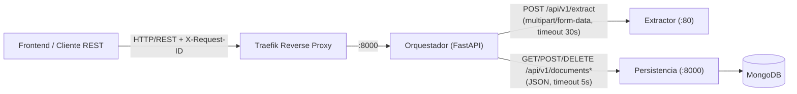
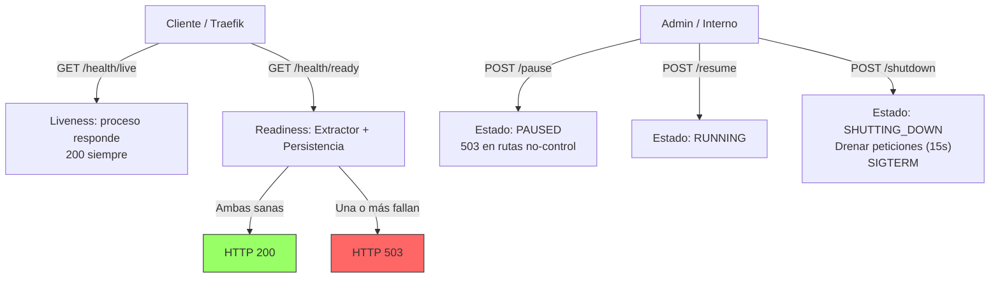

# Conectividad e Integración entre Microservicios

> **Repositorio:** Orquestador (`orchestrator-microservice_pdf-extractortext`)  
> **Propósito:** Documentar la topología de red, diagrama de flujo end-to-end, tabla de endpoints (públicos y downstream), matriz de errores y políticas de timeouts/reintentos entre los cuatro componentes del sistema (**Frontend**, **Orquestador**, **Extractor** y **Persistencia**).

---

## 1. Topología y Variables de Entorno

El sistema opera sobre una red interna de Docker Compose con enrutamiento externo a través de **Traefik** y descubrimiento por variables de entorno (ver **D1 / ADR-001** en `docs/decisiones.md`):


| Componente | Puerto interno | Variable de descubrimiento en Orquestador | Responsabilidad |
|------------|----------------|-------------------------------------------|-----------------|
| **Frontend** | `80` / `8080` | — (consumidor externo vía Traefik) | Interfaz web que envía PDFs y consulta documentos al Orquestador. |
| **Orquestador** | `8000` | — (`EXTRACTOR_SERVICE_URL`, `PERSISTENCE_SERVICE_URL`) | API Gateway / BFF stateless: valida PDF, calcula SHA-256, coordina flujo y ciclo de vida. |
| **Extractor** | `80` | `EXTRACTOR_SERVICE_URL` (ej. `http://extractor:8001`) | Extracción de texto plano y conteo de páginas a partir de bytes PDF. |
| **Persistencia** | `8000` | `PERSISTENCE_SERVICE_URL` (ej. `http://persistence:8002`) | Almacenamiento WORM en MongoDB, unicidad por checksum SHA-256 y consultas CRUD. |

---

## 2. Diagrama de Flujo

### 2.1. Arquitectura y Conectividad de Red



---

## 3. Tabla de Endpoints del Orquestador

### 3.1. Endpoints públicos (expuestos por Traefik)

Estos endpoints están bajo `PathPrefix(/api)` y son accesibles a través de Traefik:

| Método | Ruta | Descripción | Uso |
|--------|------|-------------|-----|
| `GET` | `/api/v1/control/health/live` | Liveness: verifica que el proceso responde | Healthcheck Docker/Traefik |
| `GET` | `/api/v1/control/health/ready` | Readiness: verifica dependencias (Extractor, Persistencia) | Healthcheck Docker/Traefik |
| `GET` | `/api/v1/control/health` | Alias de `/health/ready` (compatibilidad) | Healthcheck Docker/Traefik |
| `POST` | `/api/v1/documents/upload` | Sube y procesa un PDF | Frontend / Clientes REST |
| `GET` | `/api/v1/documents/` | Listado paginado de documentos | Frontend / Clientes REST |
| `GET` | `/api/v1/documents/{document_id}` | Obtiene un documento por ID | Frontend / Clientes REST |
| `GET` | `/api/v1/documents/{document_id}/download` | Descarga texto extraído como Markdown | Frontend / Clientes REST |
| `DELETE` | `/api/v1/documents/{document_id}` | Elimina un documento por ID | Frontend / Clientes REST |

### 3.2. Endpoints internos (NO expuestos por Traefik)

Estos endpoints están bajo `PathPrefix(/api)` pero están protegidos por el middleware `internal_access_middleware`. Solo son accesibles desde hosts internos (loopback: `127.0.0.1`, `::1`, `localhost`, `0.0.0.0`, `testserver`) o presentando el header `X-Internal-Token` con el valor de `INTERNAL_CONTROL_TOKEN`.

| Método | Ruta | Descripción | Protección |
|--------|------|-------------|------------|
| `GET` | `/api/v1/control/trace` | Último request/response (metadata segura, sin datos sensibles) | Interno |
| `GET` | `/api/v1/control/metrics` | Métricas operativas (requests, errores, latencias, retries, dependencias) | Interno |
| `POST` | `/api/v1/control/pause` | Pausa el servicio (503 para nuevas peticiones no-control) | Interno |
| `POST` | `/api/v1/control/resume` | Reanuda el servicio tras una pausa | Interno |
| `POST` | `/api/v1/control/shutdown` | Apagado seguro con drenado y SIGTERM | Interno |

> **Nota de seguridad:** Los endpoints de control (`/pause`, `/resume`, `/shutdown`, `/metrics`, `/trace`) no deben exponerse públicamente a través de Traefik ni ningún otro proxy inverso. Están restringidos a acceso interno por diseño.

---

## 4. Contratos Downstream

### 4.1. Orquestador → Extractor

| Llamada | Método | Ruta | Timeout | Reintentos |
|---------|--------|------|---------|------------|
| Health check | `GET` | `/health` | `HEALTH_TIMEOUT_SECONDS` (2s) | No (health check) |
| Extraer texto | `POST` | `/api/v1/extract` (multipart `file`) | `EXTRACTOR_TIMEOUT_SECONDS` (30s) | No (POST no idempotente, solo errores de transporte pre-cuerpo) |

Respuesta esperada del Extractor health: `{"status": "ok"}`.

### 4.2. Orquestador → Persistencia

| Llamada | Método | Ruta | Timeout | Reintentos |
|---------|--------|------|---------|------------|
| Chequeo duplicado | `GET` | `/api/v1/documents/by-checksum/{checksum}` | `PERSISTENCE_TIMEOUT_SECONDS` (5s) | Sí (GET idempotente, 502/503/504 y errores de transporte) |
| Crear documento | `POST` | `/api/v1/documents` (JSON) | `PERSISTENCE_TIMEOUT_SECONDS` (5s) | No (POST no idempotente) |
| Listar documentos | `GET` | `/api/v1/documents?skip=&limit=` | `PERSISTENCE_TIMEOUT_SECONDS` (5s) | Sí (GET idempotente) |
| Obtener documento | `GET` | `/api/v1/documents/{document_id}` | `PERSISTENCE_TIMEOUT_SECONDS` (5s) | Sí (GET idempotente) |
| Eliminar documento | `DELETE` | `/api/v1/documents/{document_id}` | `PERSISTENCE_TIMEOUT_SECONDS` (5s) | Sí (DELETE idempotente) |

Respuesta esperada de Persistencia health: `{"status": "ready"}`.

---

## 5. Matriz de Errores y Códigos HTTP

El orquestador traduce errores downstream al contrato uniforme `ErrorResponse`:

```json
{
  "detail": "Descripción legible",
  "code": "código_legible_por_maquina",
  "request_id": "uuid",
  "existing_id": "uuid (solo duplicados)"
}
```

### 5.1. Errores de Persistencia

| Estado downstream | Código orquestador | HTTP |
|-------------------|-------------------|------|
| 404 | `persistence_not_found` | 404 |
| 409 | `persistence_conflict` | 409 |
| 413 | `persistence_payload_too_large` | 413 |
| 422 | `persistence_unprocessable` | 422 |
| 5xx / otro | `persistence_error` | 502 |

### 5.2. Errores de Extractor

| Estado downstream | Código orquestador | HTTP |
|-------------------|-------------------|------|
| 400 | `extractor_unprocessable` | 422 |
| 422 | `extractor_unprocessable` | 422 |
| 429 | `extractor_too_many_requests` | 429 |
| 5xx / otro | `extractor_error` | 502 |

### 5.3. Errores de comunicación

| Tipo de error | Código orquestador | HTTP |
|---------------|-------------------|------|
| Timeout (`httpx.TimeoutException`) | `{service}_timeout` | 503 |
| Conexión (`httpx.ConnectError`, etc.) | `{service}_connection_error` | 503 |
| Inesperado (no-httpx) | `{service}_error` | 502 |

---

## 6. Políticas de Timeouts y Reintentos

### 6.1. Timeouts

| Variable | Default | Uso |
|----------|---------|-----|
| `HEALTH_TIMEOUT_SECONDS` | `2.0` | Timeout individual por dependencia en health checks |
| `EXTRACTOR_TIMEOUT_SECONDS` | `30.0` | Timeout del cliente Extractor |
| `PERSISTENCE_TIMEOUT_SECONDS` | `5.0` | Timeout del cliente Persistencia |

### 6.2. Reintentos (BaseClient)

| Método | Reintentos | Condiciones | Backoff |
|--------|-----------|-------------|---------|
| `GET` / `DELETE` | Hasta 3 intentos | Errores de transporte y 502/503/504 | `(0.2, 0.5, 1.0)` s |
| `POST` / otros | Hasta 3 intentos | Solo errores de transporte **antes de enviar el cuerpo** (`ConnectError`, `ConnectTimeout`, `PoolTimeout`) | `(0.2, 0.5, 1.0)` s |
| Cualquier método | Nunca | Códigos 4xx, `ReadTimeout`, respuestas 5xx en POST | N/A |

> **Nota:** Las operaciones no idempotentes (POST, PUT, PATCH) nunca se reintentan por código de estado HTTP ni ante `ReadTimeout`, para evitar duplicar efectos no deseados.

---

## 7. Diagrama de Flujo de Salud y Ciclo de Vida


